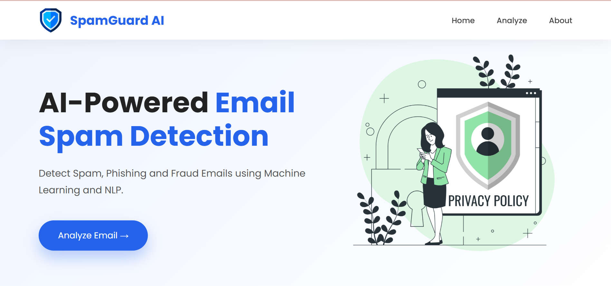
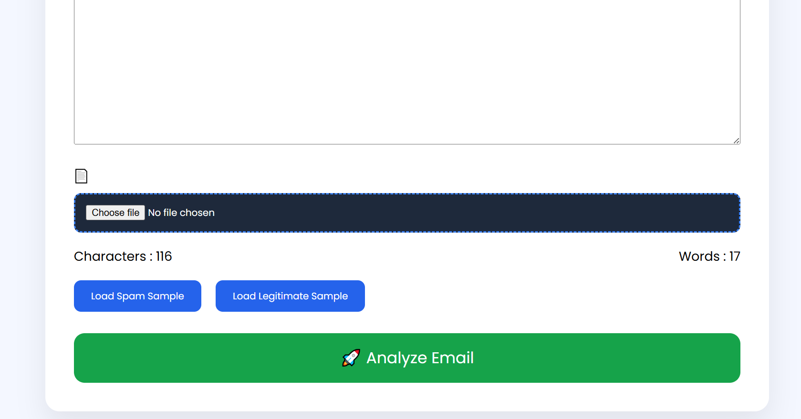
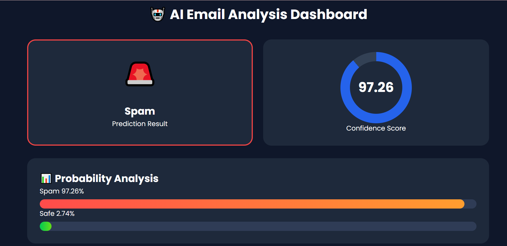
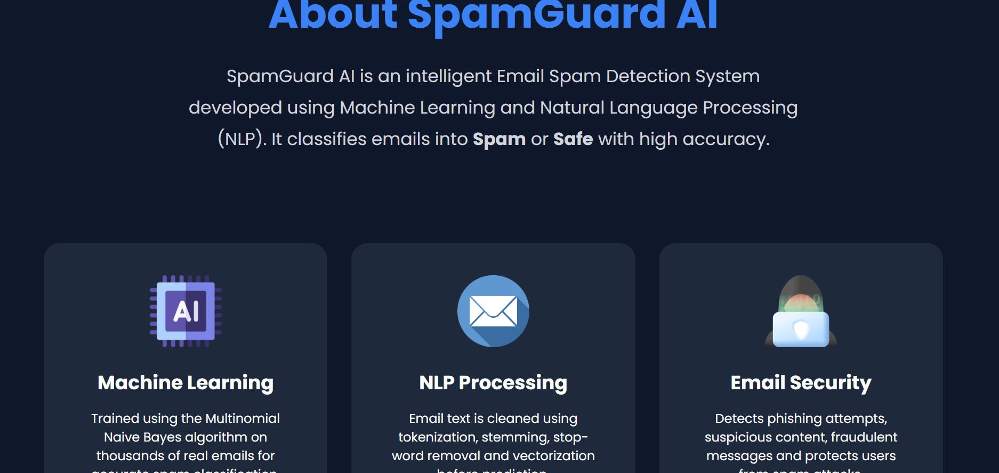

# 📧 Email Spam Detection System

An AI-powered Email Spam Detection web application built using **Machine Learning**, **Natural Language Processing (NLP)**, and **Flask**. The application classifies emails or SMS messages as **Spam** or **Not Spam** with confidence scores and an interactive user interface.

---

## 🚀 Features

- 📧 Detect Spam and Legitimate Emails
- 🤖 Machine Learning using Multinomial Naive Bayes
- 🧠 NLP Text Preprocessing (Tokenization, Stopword Removal, Stemming)
- 📄 Upload `.txt` files for analysis
- 📊 Spam & Safe Probability Analysis
- 📈 Confidence Score
- 🔍 Spam Keyword Detection
- ✍️ Character & Word Counter
- 🎨 Modern Responsive UI
- ⚡ Loading Animation

---

## 🛠 Tech Stack

### Frontend

- HTML5
- CSS3
- JavaScript

### Backend

- Python
- Flask

### Machine Learning

- Scikit-learn
- NLTK
- Pandas
- NumPy

### Tools

- VS Code
- Git
- GitHub
- Render

---

## 📂 Project Structure

```text
Email-Spam-Detection/
│
├── app.py
├── model.pkl
├── vectorizer.pkl
├── requirements.txt
├── README.md
│
├── templates/
│   ├── home.html
│   ├── analyze.html
│   ├── result.html
│   └── about.html
│
├── static/
│   ├── css/
│   ├── js/
│   ├── images/
│   └── videos/
```

---

## ⚙️ Installation

### Clone the Repository

```bash
git clone https://https://github.com/soumyahallur02-cpu/Email-Spam-Detection.git
```

### Go to the Project Folder

```bash
cd Email-Spam-Detection
```

### Install Dependencies

```bash
pip install -r requirements.txt
```

### Run the Application

```bash
python app.py
```

Open your browser and visit:

```text
http://127.0.0.1:5000
```

---

## 🖼️ Screenshots

### 🏠 Home Page



---

### 📝 Analyze Page



---

### 📊 Result Page



---

### ℹ️ About Page



---

## 📊 Machine Learning Workflow

1. Data Collection
2. Data Cleaning
3. Text Preprocessing
4. Feature Extraction (TF-IDF)
5. Model Training (Multinomial Naive Bayes)
6. Prediction
7. Probability Analysis
8. Result Visualization

---

## 📌 Future Improvements

- PDF File Support
- DOCX File Support
- User Authentication
- Email History
- Dashboard Analytics

---

## 👨‍💻 Author

**Soumya Hallur**

GitHub: https://github.com/soumyahallur02-cpu

LinkedIn: https://www.linkedin.com/in/soumya-hallur-4504a52a5?utm_source=share_via&utm_content=profile&utm_medium=member_android

---

## 📜 License

This project is licensed under the MIT License.
